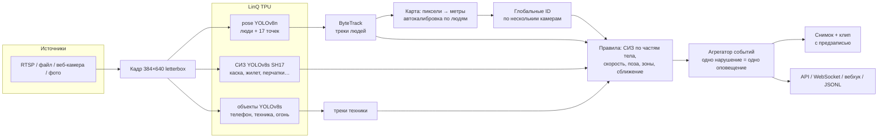

# LinQ SafetyVision — контроль нарушений промбезопасности по видео на ускорителях LinQ

ИИ-модуль для кейса «LinQ: интеллектуальный сервис контроля нарушений промышленной безопасности
по видео на российских ИИ-ускорителях LinQ». Сервис принимает видеопотоки (RTSP, файлы, веб-камеры)
или наборы фото, находит нарушения нейросетями на ускорителе LinQ, строит миникарту помещения по
одной или нескольким камерам и отправляет **одно оповещение на одно нарушение**. В оповещении есть
время начала и конца, номер камеры, зона, тип нарушения, кадр и видеоклип.

Веб-интерфейс и БД делают другие участники команды. Этот репозиторий отдаёт им HTTP API, WebSocket,
вебхуки и журнал JSONL.

**Вместе с сайтом команды** (корень этого репозитория: FastAPI + PostgreSQL + React) модуль работает через
мост [site_bridge.py](safetyvision/site_bridge.py):

```bash
python -m safetyvision bridge configs/site_bridge.yaml            # ноутбук, ONNX; --backend tpu — LinQ
```

Мост берёт с сайта камеры, векторы правил и нарисованные зоны и применяет их изменения на ходу. Каждый участок
сайта — отдельный конвейер со своей миникартой. Начало нарушения сразу уходит на сайт (тип, камера, зона,
стоп-кадр, миникарта), конец — с длительностью и видеоклипом. Живое видео с разметкой отдаётся браузеру на порту 8001,
отметки оператора «Подтвердить» / «Ложное» складываются в `runs/site_bridge/*/review` для дообучения.

---

## Что умеет

| Требование кейса | Как сделано |
|---|---|
| Видеопотоки и наборы изображений | `source:` — файл, `rtsp://…`, номер веб-камеры, папка или маска `*.jpg` ([sources.py](safetyvision/sources.py)) |
| Распознавание нарушений нейросетями | YOLOv8 «поза» (люди и 17 точек скелета), YOLOv8 «СИЗ» (SH17, 17 классов), YOLOv8 COCO (телефон, транспорт) |
| Оповещение: кадр/клип, камера, время, тип | снимок с рамкой нарушителя и MP4-клип с предзаписью ([recorder.py](safetyvision/events/recorder.py)) |
| Одно нарушение = одно оповещение | автомат idle → pending → active → ended, склейка повторов и смены ID ([aggregator.py](safetyvision/events/aggregator.py)) |
| Журнал с фильтрами (тип, камера, зона, время) | `GET /api/events?rule=&camera=&zone=&since=&until=` и `events.jsonl` |
| Инференс на LinQ, замеры FPS и задержки | компиляция в `.tpu` ([compile_tpu.py](tools/linq_compile/compile_tpu.py)), бенчмарк ([bench_tpu.py](tools/linq_bench/bench_tpu.py)), `GET /api/perf` |
| Правила и зоны под каждую камеру | **вектор правил** у площадки, камеры и зоны; зоны — полигоны на карте (м) или на кадре (px) |
| Дашборд статистики | `GET /api/stats` — по типам, камерам, зонам, часам, статусам проверки |
| Подтверждение или отклонение оператором | `POST /api/events/{id}/review`; материалы складываются в `review/` для дообучения |
| Несколько потоков | один процесс, одна плата LinQ, кадры камер обрабатываются по очереди |
| Миникарта по нескольким камерам | автокалибровка камер по людям, совмещение камер, мозаика вида сверху, слепые зоны |

### Правила (каталог)

Индекс правила — это позиция в векторе, который подаётся вместе с видеопотоком:

```
python -m safetyvision rules
 #  код                важность  нейросети        описание
 0  helmet             medium    pose+ppe         Нет защитной каски
 1  vest               medium    pose+ppe         Нет спецодежды (жилет/комбинезон)
 2  smoking            high      pose+objects     Курение
 3  phone              medium    pose+objects     Использование телефона
 4  running            medium    pose             Бег по цеху
 5  danger_zone        high      pose             Нахождение в опасной зоне
 6  vehicle_proximity  high      pose+objects     Опасное сближение с техникой
 7  fall               critical  pose             Падение / человек лежит
 8  fire               critical  objects          Открытый огонь / дым
 9  gloves             low       pose+ppe         Нет перчаток
10  goggles            low       pose+ppe         Нет защитных очков/щитка
```

Пример из постановки — «в секторе C можно без каски и формы, но курить нельзя»:

```yaml
cameras:
  - id: cam3
    source: rtsp://10.0.0.13/stream
    rules: [0, 0, 1, 0, 0, 0, 0, 0, 0]
```

Правила накладываются слоями: площадка → камера → зоны (по `priority`). Зона может разрешить то,
что запрещено на камере (курилка: `rules: {smoking: 0}`). Опасная зона (`kind: danger`) сама включает
правило `danger_zone`. У зоны может быть расписание (`schedule: ["08:00-12:00"]`). Динамическая
зона (`kind: dynamic`, `attach_to: vehicle`, `radius_m: 3`) — это круг вокруг движущейся техники.
Новые правила добавляются в конец каталога, поэтому старые векторы остаются валидными.

Нейросети запускаются, только если на камере может действовать правило, которому они нужны. Если
на камере выключены все правила СИЗ, детектор СИЗ на ней не вызывается, и ускоритель свободен для
других потоков.

---

## Архитектура



**Нейросети на LinQ.** От голов YOLO на ускоритель уходят только свёртки. Декодирование (DFL, якоря,
sigmoid, NMS) идёт на CPU в numpy ([yolo.py](safetyvision/inference/yolo.py)). LinQ так же
поступает со своими эталонными yolov8n_pose и yolov8m_seg. Поэтому одна и та же модель одинаково
работает через onnxruntime на ноутбуке и через `pytpu` на LinQ. Бэкенд выбирается флагом
`--backend onnx|tpu`.

**СИЗ по частям тела.** Каска засчитывается, только если она попала в область головы человека,
построенную по точкам скелета. Жилет должен покрывать корпус (плечи и бёдра), перчатки — кисти.
Поэтому каска в руке или на соседе не засчитывается. Если голову не видно (спиной, перекрытие,
слишком мелко), правило отвечает «не видно», а не «нарушение». Для малых СИЗ детектор запускается
на увеличенном окне вокруг людей.

**Ложные срабатывания отсекаются временем.** Событие возникает, только если нарушение держится
`confirm_s` секунд и доля кадров с нарушением в окне не меньше `ratio`. Событие закрывается после
`clear_s` секунд без нарушения. Повтор того же нарушения тем же человеком в течение `merge_s`
переоткрывает старое событие, а не создаёт новое. Если трекер сменил человеку ID, новое наблюдение
привязывается к событию рядом по месту. Все параметры настраиваются для каждого правила в
`site.rule_params`.

### Карта помещения по камерам

1. **Автокалибровка по людям** ([autocalib.py](safetyvision/geometry/autocalib.py)). Для стоящего
   человека известны пиксели стоп и макушки, а рост около 1.7 м. Методом наименьших квадратов
   подбираются фокус, наклон, крен и высота камеры. После этого пол кадра переводится в метры:
   скорость бега в м/с и расстояние до погрузчика в метрах. На синтетике параметры
   восстанавливаются с точностью ±0.5 м по высоте и ±3° по наклону (`tests/test_geometry.py`).
2. **Совмещение камер.** Камеры одного помещения видят одних и тех же людей в одни и те же моменты.
   RANSAC по одновременным положениям людей находит поворот и сдвиг между системами координат.
3. **Миникарта** ([render.py](safetyvision/render.py), `draw_minimap`) — плоская схема помещения, как
   план эвакуации. Помещение — серый контур (`map.room` или прямоугольник вокруг зон обзора). Зоны
   обзора камер светлее пола, **слепые зоны** (их не видит ни одна камера) заштрихованы. Камеры —
   треугольники с номером, вершина в месте камеры, основание в сторону обзора. Люди — кружки с
   глобальным номером, цвет по статусу: белый — норма, оранжевый — проверка, красный — нарушение.
   Опасные зоны — красные, техника — чёрный квадрат с розовой зоной вокруг. Внизу легенда, линейка
   масштаба и список камер. Схема рисуется сразу в размере вывода, поэтому подписи читаются и в
   видео. Те же данные в метрах отдаёт API (`/api/map`) для отрисовки на фронтенде.
4. Если есть план цеха, можно задать `map.background` и 4+ точки соответствия «кадр ↔ карта» на камеру
   (`calibration.image_points / map_points`) или прислать их через API.
5. Человек, которого видят две камеры, получает один глобальный ID ([fusion.py](safetyvision/fusion.py)).
   Его нарушение — одно событие, а не два.

**Проверка на реальной паре камер** — CAVIAR, торговый коридор, виды «cor» и «front», 384×288
([configs/caviar_2cam.yaml](configs/caviar_2cam.yaml)):

- «cor» откалибровалась по прохожим без разметки: высота 3.7 м, наклон 23°, ошибка роста 7%.
- В «front» люди идут поперёк кадра почти на одном расстоянии, и фокус по ним не определить. Для
  таких камер есть параметр `auto.hfov_deg`: угол обзора из паспорта камеры. Тогда подбираются
  только наклон и высота.
- Записи сдвинуты на 3.12 с (видно по штампу времени в кадре). Сдвиг задаётся `start_offset_s`.
- Совмещение по одновременным положениям людей: поворот 126°, 25 согласованных точек, медианная
  ошибка 0.35 м. Когда человека видят обе камеры, его положения на карте расходятся в среднем на
  0.85 м.
- `python -m safetyvision calibrate …` печатает готовые блоки `calibration` (модель камеры и место на
  карте). С ними, как в [configs/caviar_2cam_calibrated.yaml](configs/caviar_2cam_calibrated.yaml),
  карта и общие ID готовы с первого кадра.

---

## Быстрый старт (ноутбук, ONNX)

```bash
python -m venv .venv && .venv/bin/pip install ultralytics onnx onnxslim onnxruntime opencv-python \
    numpy scipy shapely lap pyyaml fastapi uvicorn pillow pytest
# 1. экспорт моделей (обрезанная голова, фиксированный вход 384×640) + сверка с Ultralytics
.venv/bin/python tools/export_onnx.py --weights data/weights/yolov8n-pose.pt --name pose_v8n --verify-image data/samples/zidane.jpg
.venv/bin/python tools/export_onnx.py --weights data/weights/sh17_yolov8s.pt --name ppe_sh17s --verify-image data/samples/bus.jpg
.venv/bin/python tools/export_onnx.py --weights data/weights/yolov8s.pt     --name coco_v8s  --verify-image data/samples/bus.jpg
# 2. прогон видео: события, клипы, видео с разметкой и миникартой
.venv/bin/python -m safetyvision run configs/demo_single.yaml --save-video runs/demo.mp4
# 3. API для веб-интерфейса (документация Swagger: http://localhost:8000/docs)
.venv/bin/python -m safetyvision serve configs/demo_single.yaml --port 8000
# тесты
.venv/bin/python -m pytest -q tests
```

## Запуск на ускорителе LinQ

Модели компилируются у себя в Docker: SDK `tpu_framework` есть только под linux x86_64 и Python 3.12.
Готовые `.tpu` загружаются на сервер LinQ.

```bash
# образ компилятора (один раз): SDK из vendor/linq_sdk + torch CPU
docker build --platform linux/amd64 -t linq-tpu-compiler:2026.9.45 tools/linq_compile
# компиляция: калибровка на реальных кадрах, сверка int8 с fp32, O5 (при ошибке откат на O1)
docker run --rm --platform linux/amd64 -v "$PWD":/work -w /work linq-tpu-compiler:2026.9.45 \
    python tools/linq_compile/compile_tpu.py --spec models/pose_v8n_384x640.json --calib data/calib --preset o5
```

Результат компиляции:

| Модель | Пресет | Время компиляции | Близость int8 к fp32 (косинус, мин. по выходам) |
|---|---|---|---|
| pose_v8n_384x640 | O5 | 32 c | 0.989 |
| ppe_sh17s_384x640 | O5 | 60 c | 0.986 |
| coco_v8s_384x640 | O5 | 52 c | 0.979 |
| helmet_cls_v8n_v2_96 (вход 96×96) | O5 | 17 c | 0.984 (логиты; обманчиво — см. «Точность int8 на плате») |

Классификатор YOLOv8-cls в исходном виде не компилируется ни с O5, ни с O1: компилятор падает на
Reshape 4D→2D перед Gemm. [export_onnx.py](tools/export_onnx.py) заменяет Linear эквивалентной
свёрткой 1×1 (вероятности совпадают до 0.0). Softmax считается на CPU. Детектор сигарет YOLO26s
(attention: MatMul/Softmax) не компилируется, поэтому сигареты ищет собственный YOLOv8s (см. ниже).

Затем на сервере LinQ (VPN → http://hackathon.lin-q.ru/ → Jupyter → терминал):

```bash
bash tools/make_bundle.sh                    # локально: dist/linq_bundle.tar.gz (код, .tpu, конфиги, видео)
# перетащить архив в файловую панель Jupyter (~/work), затем в терминале Jupyter:
mkdir -p ~/work/linq && cd ~/work/linq && tar xzf ~/work/linq_bundle.tar.gz
pip install --user -q --no-deps "opencv-python-headless==4.10.0.84"   # остальное на сервере уже есть
python tools/linq_bench/bench_tpu.py --iters 100 --streams 4           # задержка и пропускная способность
python -m safetyvision run configs/demo_linq.yaml --backend tpu --duration 30 --save-video runs/linq_demo.mp4
python tools/linq_bench/dump_tpu.py          # снимок выходов TPU -> сверка с ONNX на ноутбуке (--compare)
```

Окружение сервера собрано под numpy 1.x (`tpu-pycloud-format`, numba, matplotlib). Свежий opencv
тянет numpy 2 и ломает его, поэтому зависимости в [requirements-linq.txt](requirements-linq.txt)
ограничены по версиям, а opencv ставится с `--no-deps`.

#### Как устроен инференс на сервере хакатона

Платы в контейнере Jupyter нет, `pytpu` там не установлен. Инференс идёт через облачный сервис LinQ:
брокер RabbitMQ (`10.0.114.30:5672`, exchange `tpu.direct`, очередь `input`) передаёт тензоры
воркеру с платой. `.tpu`-программа должна лежать в `/auto/cache/<LOGIN>`, путь к ней уходит в
заголовке задачи. [CloudTpuBackend](safetyvision/inference/backends.py) делает это сам:

- копирует программу в `/auto/cache/<LOGIN>` (логин берётся из имени пользователя или `LINQ_LOGIN`);
- держит одно соединение и одну очередь ответов (`exclusive`) на модель, а не открывает их на кадр;
- умеет отправлять несколько кадров сразу (`run_many`), чтобы сеть не простаивала;
- `--backend tpu` выбирает `pytpu`, если плата стоит в той же машине, иначе облако.

В пайплайне детекторы объектов отправляются параллельно с позой: кадр ждёт две круговые задержки
сети вместо трёх.

#### Точность int8 на плате

[dump_tpu.py](tools/linq_bench/dump_tpu.py) снимает выходы TPU на 4 кадрах,
[sim_quant.py](tools/linq_compile/sim_quant.py) прогоняет те же входы через эмуляцию квантования в
SDK. Эмуляция совпала с платой до косинуса 1.000, поэтому подбирать квантование можно у себя в
Docker, не нагружая сервер.

| Модель | Косинус TPU/ONNX (мин. по выходам и кадрам) | Детекции TPU/ONNX |
|---|---|---|
| pose YOLOv8n | 0.953 | 9 из 9 |
| объекты YOLOv8s (COCO) | 0.979 | 11 из 14 |
| опасности YOLOv8s | 0.931 | 0 из 0, 1 лишняя |
| СИЗ YOLOv8s (SH17) | 0.856 | 36 из 46 |
| классификатор каски | 0.916 | см. ниже |

Классификатор каски int8 не переносит: на 300 размеченных вырезках точность 0.57 против 0.98 в
fp32, 113 касок из 150 он называет «без каски». Логит — разность двух почти противоположных сумм по
1280 признакам, и ошибка int8 её перекрывает. Смена калибровки (сбалансированные вырезки, максимум
вместо перцентиля, `activation_percentile`) и дообучение порогов SDK (`--fine-tune`) не помогли.
Поэтому классификатор (96×96, вызывается только на спорных головах, 2–4 мс) работает на CPU:
`backend: cpu` в конфиге, на сервере через OpenCV DNN. Все детекторы остаются на TPU.

Модель СИЗ на эмуляции находит 81% детекций fp32 (30 кадров с 6 роликов, IoU > 0.5 и тот же класс),
хуже всего каски (6 из 10) и мелкие объекты. Калибровка на всех 62 кадрах с порогом по максимуму
вместо перцентиля 99.99 даёт 82% (каски 7 из 10). Эта версия и стоит в бандле. Пропущенную каску
страхует классификатор на CPU: голову без каски он перепроверяет, прежде чем поднять тревогу.

### Проверка на роликах

Ни один ролик не использовался для обучения. Каждое нарушение проверено по снимку.

| Ролик | Что в кадре | События | Итог |
|---|---|---|---|
| construction_walk (Pexels) | рабочие в касках и жилетах, тёмная каска сзади, щётка на плече | 0 | ложных нет |
| warehouse_walk (Pexels) | трое на складе без касок и жилетов | 2 каски, 3 жилета | верно; кепку со спины (3-й) пропускает |
| indoor_walk (Pexels) | рабочий в чёрной каске, спиной | 0 | ложных нет |
| forklift (Pexels) | погрузчик, водитель без каски | каска 1, жилет 1 | верно; сближения с погрузчиком нет |
| phone_hardhat (Pexels) | разговор по телефону | телефон 1, жилет 1 | верно |
| URFD fall-01/05/12 | падение в помещении | падение 3/3, каска и жилет 2/2 | верно |
| CAVIAR cor+front | 2 камеры, коридор | карта, общие ID | см. «Карта помещения» |
| hardhat_walk (Pexels) | съёмка с рук на ходу, машина у тротуара | сближение 1 | ложное: камера движется, стоящая машина «едет» |
| fire_barrel (Pexels) | костёр в бочке, люди рядом | огонь 1 (29 с) | верно: один очаг — одна тревога |
| welding (Pexels) | сварка крупным планом, искры | 0 | ложных нет: искры редки, крупный план не «лежит» |

**Заводы, неподвижная камера** ([configs/factory/](configs/factory)). Опасные зоны размечены на кадре
(`polygon_px`) по реальным опасностям в сцене. Когда камера откалибрована, они переносятся на карту.

| Ролик (Pexels) | Что в кадре | События | Итог |
|---|---|---|---|
| valve_plant 32243444 | монтаж арматуры, 5 рабочих в касках и синих жилетах | зона «под подвешенным грузом» 1 | верно: рабочий под висящей задвижкой. Карта построена (камера 2.75 м, наклон 12°). Раньше было и ложное «нет жилета» на рабочем в расстёгнутом жилете в тени, исправлено (см. ниже) |
| steel_crane 33855578 | пролёт кран-балки, дым, рабочие в кепках | зона «под грузом крана» 4, каска 3, жилет 5, дым 1 | верно; стопы обрезаны краем кадра, поэтому калибровки и карты нет. Раньше на кадре мигали рамки «дыма» на лампе над стрелой крана, исправлено (см. ниже) |
| warehouse_forklift 32243654 | погрузчик и пешеход без каски | каска 1, жилет 2, «радиус погрузчика» 1 | верно: пешеход в 2.7 м от едущего погрузчика; водитель в кабине не «пешеход в проезде» |
| line_fence 38806070 | линия розлива за жёлтым ограждением | «площадка конвейера» 1 | верно: человек на площадке за ограждением |
| warehouse_caps 4293552 | трое на складе в шапках и рабочих куртках | каска 3, жилет 3 | верно для требования «каска и сигнальный жилет» |
| intel_floor_zone (Intel, 76 с) | склад сверху, жёлто-чёрная ограничительная линия, люди в касках и жилетах ходят по всему полу | зона «за ограничительной линией» 7 | верно: 7 заходов за линию. Один человек ушёл, вернулся под новым ID и дал 2 события. Камера откалибровалась по прохожим, зона и люди на карте |
| intel_corridor_ppe (Intel, 65 с) | коридор, люди идут к камере | каска 2, жилет 2 | верно: женщина в чёрном — без каски и жилета; мужчина в чёрном в группе — без жилета; женщина в фиолетовом — без каски. На женщине в оранжевом жилете поверх оранжевой куртки тревоги нет |

Что исправлено по итогам этих роликов:

- **Цвет жилетов площадки.** SH17 знает только жёлтые и оранжевые жилеты, синие не видит даже при
  пороге 0.05. В `rule_params.vest.vest_colors` задаются цвета, принятые на площадке (`blue`,
  `yellow`, `orange`, `lime`, `green`, `red`). Доля цвета считается по середине корпуса и отдельно
  по обоим бокам: у расстёгнутого жилета поверх тёмной куртки видны только полы слева и справа.
  Пороги яркости у синего ниже, чем у флуоресцентных цветов: синяя ткань в тени остаётся
  насыщенной, но темнеет. Цвет — слабый признак, поэтому исходов три:
  - доля ≥ 35% (`vest_color_min_frac`) — жилет есть;
  - доля < 15% (`vest_color_unsure_frac`) — нарушение;
  - между ними — «не видно», без тревоги.

  У рабочего в расстёгнутом жилете в тени доля 21–32%, у людей без жилета в коричневых куртках на
  складе 2–15%.
- **Водитель техники.** Человек, чья рамка на 60% внутри рамки погрузчика, — водитель. Признак держится
  2 с, потому что детектор теряет рамку техники на отдельных кадрах. К водителю не применяются:
  - зоны проезда;
  - правило сближения;
  - «бег»: его скорость — это скорость машины, раньше водитель едущего погрузчика «бежал».

  Правила СИЗ к водителю применяются.
- **Одна машина — одна рамка.** Погрузчик находят и модель опасностей («forklift»), и COCO
  («truck»). Пересекающиеся рамки сливаются, вид — погрузчик.
- **Радиус техники без калибровки.** Расстояние считается до нижнего края рамки техники, а метры —
  по росту самого человека. Высота рамки погрузчика зависит от поднятой мачты, по ней масштаб
  раздувался.
- **Одно нарушение — одно событие и после калибровки.** Когда камера откалибровалась посреди
  нарушения, ключ человека менялся с `cam1:p1` на глобальный `g1`, и событие распадалось на два.
  Теперь состояние переносится (`EventAggregator.rename`). Так же сливаются два события, если две
  камеры подняли тревогу на одного человека до объединения его ID.
- **Калибровка по одному человеку** (`auto.min_tracks: 1`) требует вдвое большего разброса по
  глубине: по одному пешеходу, идущему поперёк кадра, наклон и высота камеры взаимозаменяемы
  (получалось 5.3 м и 27° у низкой камеры).
- **Дальность карты** `map.max_range_m` (по умолчанию 25 м). Для цеха разумно 12 м, иначе люди
  теснятся у камеры на пустой карте.
- **На кадре только то, что участвует в правилах.** Раньше рисовались все рамки детекторов выше
  порога модели, в том числе «дым» 0.3–0.4 на лампе над стрелой крана, который правило всё равно
  отбрасывает. Теперь:
  - сигарета и телефон рисуются, только когда они у руки или лица человека;
  - огонь и дым рисуются одной сглаженной рамкой очага и только пока правило копит подтверждение
    или уже сработало.
- **Маленький «дым» — не дым.** Рамка дыма меньше 1% кадра (`fire.smoke_min_area`) не учитывается:
  задымление — облако, а маленькая «дымка» — почти всегда блик лампы или прожектора.
- **Люди, по очереди проходящие через зону, — разные события.** Раньше новое нарушение того же
  правила рядом с местом начала недавнего события (15 с) считалось тем же человеком с новым ID трека.
  На складе Intel пятеро прошедших через зону склеились в одно событие на 39 с. Теперь склейка по
  месту — только при настоящей смене ID:
  - прежнего человека уже не видно;
  - новый трек родился не позже 3 с после этого (`relink_gap_s`);
  - новый трек рядом с местом, где прежнего видели последний раз, а не где событие началось.
- **Память СИЗ без чужих жилетов.** «Каску/жилет на этом человеке недавно видели» (`memory_s`, 6 с)
  записывается только когда человек не перекрыт другим (`occluded_overlap`). Для жилета ещё нужно,
  чтобы детекция была уверенной (≥ 0.5) и по центру корпуса. Мужчине в чёрном в группе в коридоре
  достался край жилета соседки, которая выглядывала из-за спины, и 6 с он считался «в жилете».
- **Цвет сигнальной одежды по умолчанию.** Если цвета площадки не заданы, запасной признак жилета —
  флуоресцентные жёлтый, оранжевый и лайм (сигнальная одежда по ГОСТ 12.4.281). SH17 не видел
  оранжевый жилет поверх оранжевой куртки. Тёмная и коричневая одежда под эти пороги не попадает:
  на всех роликах регрессии нарушения «нет жилета» остались прежними. `vest_colors: []` отключает
  проверку.
- **Сигарета не крупнее сигареты.** Детектор опасностей принял бутылку в руке за сигарету (0.70).
  Теперь рамка сигареты не может быть длиннее 0.45 и шире 0.25 ширины плеч того же человека
  (`cig_max_len`, `cig_max_width`): сигарета ~9×1 см при плечах ~40 см. Бутылка, маркер и фонарик
  отсекаются, регрессия не изменилась.
- **Подпись зоны** — у верхней вершины самой зоны, а не в углу описывающего прямоугольника: у косой
  зоны он вне её, и подпись висела над людьми.
- **Короткие подписи над людьми:** «#1 без каски, без жилета, опасная зона». Полные названия
  остаются в событиях и API. Длинные строки у соседних людей налезали друг на друга.

Падение: после падения рамка человека из высокой становится широкой, а детектор у лежащего
неуверен (0.4–0.6). Трекер перепривязывает такую детекцию к тому же человеку по месту стоп
([bytetrack.py](safetyvision/tracking/bytetrack.py), этап 2b). Без этого 2 падения из 3 терялись.
Наоборот, сварщик вплотную к камере даёт широкую рамку с горизонтальным корпусом и раньше считался
лежащим. Теперь человек выше 55% кадра не может «лежать»: это крупный план.

Огонь: все рамки огня и дыма в кадре камеры — один инцидент. Кадры, где детектор отработал и огня не
нашёл, идут в правило как «огня нет». Без них доля кадров с огнём всегда была бы 1, и редкие ложные
срабатывания на искрах сварки (8% кадров) складывались в тревогу.

### Замеры производительности

Сервер LinQ, облачный инференс, 100 замеров на модель. Задержка круговая: отправка тензора,
очередь, плата, ответ. Вход float32 1×3×384×640 — 2.9 МБ, и примерно столько же занимают выходы,
поэтому время уходит в основном на передачу данных.

| Модель (вход 384×640) | ONNX, CPU Apple M4 | LinQ TPU, задержка (p95) | LinQ TPU, 4 кадра в полёте |
|---|---|---|---|
| pose YOLOv8n | 12–15 мс | 120 мс (215) | 17.7 FPS |
| СИЗ YOLOv8s (SH17) | 33 мс | 107 мс (238) | 20.7 FPS |
| объекты YOLOv8s (COCO) | 28–33 мс | 134 мс (271) | 15.7 FPS |
| опасности YOLOv8s | 41 мс | 111 мс (239) | 21.6 FPS |
| классификатор каски 96×96 | 3 мс | 14 мс (65) | 351 FPS |

Связка «4 камеры, поза на каждом кадре, СИЗ и объекты через кадр» на одной плате: 9 кадров в
секунду суммарно (`runs/bench_tpu.json`). Демо `demo_linq.yaml` (2 камеры, 4 модели, кадры по
одному) на сервере идёт 1.6–1.85 FPS на камеру (меньшее — с записью видео с разметкой) и даёт те же
события, что и ONNX на ноутбуке на тех же кадрах (0 событий; до переноса классификатора на CPU была
одна ложная «нет каски»). Воркер возвращает поле `inference_time`, но для
классификатора оно больше всей круговой задержки (28.8 мс против 7.3 мс), поэтому как «время на
плате» мы его не используем.

Повторный замер 24.10 (30 замеров на модель) дал ту же пропускную способность: 4 кадра в полёте —
15.7–21.9 FPS на детекторах, связка 4 камер — 9.1 кадра в секунду. Одиночная задержка была на 10–30%
выше (133–155 мс, p95 до 274 мс): она зависит от загрузки общей очереди облака.

Пайплайн целиком (декодирование, трекинг, правила, клипы) на ноутбуке: 50–90 мс на кадр одной
камеры. Задержка до тревоги равна `confirm_s` правила (0.6–3 с) плюс время обработки кадра, то есть
укладывается в «несколько секунд» из кейса. Каждое событие хранит `detect_latency_s` и
`processing_latency_s`.

---

## Как снять своё демо (2–3 телефона в одной комнате)

1. **Камеры.** Телефоны на штативах или приклеены к стене на высоте 2–3 м, смотрят немного вниз,
   без зума, в горизонтальной ориентации. Видео 1080p, 25–30 кадров/с. Пока идёт запись, телефоны
   не трогать: скорость и расстояния считаются по полу.
2. **Перекрытие.** Каждый участок пола, где ходят люди, должна видеть хотя бы одна камера. Половину
   комнаты лучше видеть двумя камерами: по общим людям они совмещаются на карте.
3. **Синхронизация.** Включить запись на всех телефонах, затем хлопнуть в ладоши в кадре всех камер.
   Сдвиг между файлами задаётся `start_offset_s`.
4. **Калибровка.** Первые 30–40 секунд 2–3 человека ходят по всей комнате: к камере, от камеры,
   поперёк. По ним каждая камера калибруется сама. Если известен угол обзора телефона (основная
   камера — около 65–70° по горизонтали), задайте `calibration.auto.hfov_deg`. Тогда хватит
   меньшего числа проходов.
5. **Сценарии.** По 10–20 секунд на каждый, с паузами между ними:
   - без каски и без жилета, затем в каске и жилете (одна тревога на человека, а не на кадр);
   - бег через комнату;
   - вход в опасную зону: её контур на полу обклеить скотчем и задать в `zones`;
   - разговор по телефону;
   - падение: медленно сесть и лечь на мат;
   - имитация курения (ручка у рта);
   - «сектор C»: камера с вектором правил `[0,0,1,…]` — тревога только на курение.
6. Файлы положить в `data/videos/room/cam1.mp4`, `cam2.mp4`, `cam3.mp4` и запустить
   `python -m safetyvision calibrate configs/demo_room.yaml`, затем `run … --save-video`.

## API для веб-интерфейса и БД

`python -m safetyvision serve <config> --port 8000`, Swagger — `/docs`, отладочная страница — `/`.

| Метод | Путь | Что делает |
|---|---|---|
| GET | `/api/rules` | каталог правил (индекс = позиция в векторе) |
| GET | `/api/config` | камеры, зоны, карта, действующие векторы правил |
| PUT | `/api/cameras/{id}/rules` | `{"rules": [0,0,1,0,…]}` или `{"rules": {"smoking": 1}}` — на лету |
| POST | `/api/cameras/{id}/calibration` | `{"image_points": [[u,v]…], "map_points": [[x,y]…]}` |
| GET/POST/DELETE | `/api/zones` | зоны: `polygon` (метры карты) или `camera` + `polygon_px` (пиксели) |
| GET | `/api/events` | журнал; фильтры `rule, camera, zone, status, review, since, until, limit, offset` |
| POST | `/api/events/{id}/review` | `{"status": "confirmed"|"rejected", "comment": "…"}` |
| GET | `/api/stats` | счётчики по типам, камерам, зонам, часам |
| GET | `/api/perf` | FPS и задержки по камерам и моделям, статус калибровки |
| GET | `/api/map`, `/api/map.png` | люди, техника, зоны, камеры, слепые зоны (метры) / картинка миникарты |
| GET | `/api/cameras/{id}/frame.jpg`, `/stream` | кадр с разметкой / MJPEG-поток |
| WS | `/ws/events` | поток событий `started`, `reopened`, `ended`, `reviewed` |
| GET | `/media/<snapshot|clip>` | снимки и клипы |

Событие (то же в WebSocket, вебхуке и `events.jsonl`):

```json
{"id": "2c5e18efd247", "rule": "helmet", "rule_index": 0, "title": "Нет защитной каски",
 "severity": "medium", "status": "ended", "camera_id": "cam1", "cameras": ["cam1"],
 "zone_ids": [], "zone_names": [], "subject": "g12", "track_ids": ["g12"],
 "start_ts": 1792783319.57, "end_ts": 1792783329.33,
 "start_time": "2026-10-23T22:21:59.572", "end_time": "2026-10-23T22:22:09.332", "duration_s": 9.76,
 "confidence": 0.81, "bbox": [710, 138, 1083, 717], "map_xy": [12.4, 7.9],
 "snapshot": "snapshots/2c5e18efd247.jpg", "clip": "clips/2c5e18efd247.mp4", "clips": ["clips/2c5e18efd247.mp4"],
 "reopen_count": 0, "details": {"head_px": 52.1}, "review": {"status": "pending"},
 "detect_latency_s": 2.0, "processing_latency_s": 0.061}
```

Жизненный цикл: `started` (тревога, один раз, со снимком) → `ended` (время конца и клип). Если
нарушение возобновилось в течение `merge_s`, приходит `reopened` с тем же `id`, без новой тревоги.

---

## Модели и данные

| Роль | Модель | Классы | Источник и лицензия |
|---|---|---|---|
| pose | YOLOv8n-pose | человек + 17 точек COCO | Ultralytics, AGPL-3.0 |
| СИЗ | YOLOv8s, обучена на SH17 | person, head, face, helmet, safety-vest, safety-suit, gloves, hands, glasses, face-guard, … (17) | SH17 dataset (8 099 фото с производств), CC BY-NC-SA 4.0 |
| объекты | YOLOv8s COCO | cell phone, car, truck, bus, motorcycle | Ultralytics |
| helmet_cls | YOLOv8n-cls 96×96, **обучена нами** | helmet / no_helmet по вырезке головы | см. ниже |
| объекты (опасности) | YOLOv8s, **обучена нами** | cigarette, fire, smoke, forklift | см. ниже |

**Классификатор каски** ([build_helmet_cls.py](tools/datasets/build_helmet_cls.py),
[mine_hard_negatives.py](tools/datasets/mine_hard_negatives.py)) проверяет голову перед тревогой
«нет каски». Детектор SH17 пропускает тёмные и повёрнутые каски, и голова «без каски» без такой
проверки давала ложные тревоги.

- Данные: 18 тыс. вырезок голов из hard-hat-detection (Roboflow, CC BY 4.0) и Construction-PPE.
  Вырезаются так же, как в рантайме: рамка головы, поле 15%, квадрат.
- Версия v2 дообучена на 243 трудных негативах: кепки, шляпы, капюшоны, причёски из фото людей вне
  стройки. Кандидаты отобраны автоматически, 30 шлемов (военные, велосипедные, мотоциклетные)
  отбракованы вручную.
- Отложенная проверка. Рабочий порог p(no_helmet) — 0.85 (`verify_no_helmet`):

  | Показатель | v1, порог 0.9 | v2, порог 0.9 | v2, порог 0.85 |
  |---|---|---|---|
  | Головы без каски | 95% | 94% | 95% |
  | Трудные негативы | 0% | 71% | 74% |
  | Ложное «без каски» на касках | 0.46% | 0.43% | 0.46% |

- На тестовых роликах ложные тревоги из-за чёрной каски со спины ушли, все настоящие нарушения
  остались (таблица ниже).

**Детектор опасностей** ([build_hazards.py](tools/datasets/build_hazards.py)):

- D-Fire: огонь и дым, 4 из 9 частей набора.
- keremberke/forklift (CC BY 4.0): погрузчики.
- Сигареты: фото курящих (ccclllwww/smoking_img_final), размеченные моделью-учителем
  basant18/Smoking-detection-YOLO26s (Apache-2.0). Сам учитель на LinQ не компилируется.
- Негативы: люди на стройке и некурящие.
- Всего 6 836 фото для обучения и 1 632 для проверки.

Рецепты обучения — [tools/train_models.py](tools/train_models.py).

Данные для проверки и дообучения (`data/`):

- `data/datasets/construction-ppe` — Ultralytics Construction-PPE (1 416 фото: helmet, vest, gloves,
  boots, goggles и их отсутствие);
- `data/datasets/raw/hardhat` — hard-hat-detection (head / helmet / person);
- `data/videos/pexels` — ролики со стройки и склада с погрузчиками (лицензия Pexels);
- `data/videos/caviar` — CAVIAR (EC Funded CAVIAR project/IST 2001 37540), пары синхронных камер;
- `data/videos/urfd` — UR Fall Detection Dataset (Kwolek, Kepski 2014; CC BY-NC-SA 4.0), падения;
- `data/videos/factory` — заводские ролики с неподвижной камерой, уменьшенные до 1280×720 (исходники
  в `data/videos/factory_raw` и `data/videos/intel`):
  - ролики Pexels — лицензия Pexels;
  - `intel_floor_zone.mp4` — `worker-zone-detection.mp4` из
    [intel-iot-devkit/sample-videos](https://github.com/intel-iot-devkit/sample-videos), © Intel, CC BY 4.0;
  - `intel_corridor_ppe.mp4` — `Safety_Full_Hat_and_Vest.mp4` из
    [intel-iot-devkit/safety-gear-detector-python](https://github.com/intel-iot-devkit/safety-gear-detector-python),
    © Intel, лицензия репозитория BSD-3-Clause;
- `data/calib` — кадры для калибровки квантования.

**В репозитории** (63 МБ, чтобы всё запускалось сразу): `data/videos/factory` (конфиги `configs/factory/*.yaml`
и демо-камеры сайта), `data/videos/demo` (`configs/demo_linq.yaml`), пара камер CAVIAR `ThreePastShop1*`
(`configs/caviar_2cam*.yaml`, карта из двух камер) и `data/samples`. Наборы фото, остальные ролики, исходники
моделей и `.pt`-веса в репозиторий не входят: они большие, ссылки на источники — выше. Конфиги, которым нужны
эти ролики (`demo_single`, `demo_hazards`, `demo_room`), работают с флагом `--source <своё видео>`.

Подтверждённые и отклонённые оператором события копируются в `runs/*/review/{confirmed|rejected}/<rule>/`
(снимок + JSON). Это готовый набор для дообучения на объекте заказчика.

## Структура

```
safetyvision/
  catalog.py            каталог правил и вектор
  config.py             конфигурация площадки (YAML)
  inference/            бэкенды ONNX / LinQ TPU, декодер YOLO
  tracking/bytetrack.py трекер
  geometry/             гомография, автокалибровка, зоны, миникарта
  analytics/            оценка правил по кадру
  events/               агрегатор событий, клипы, журнал, вебхуки
  fusion.py             глобальные ID по камерам
  pipeline.py           конвейер
  server.py             HTTP API / WebSocket
tools/
  export_onnx.py        .pt → ONNX с «сырыми» выходами + сверка
  datasets/             сборка наборов: вырезки голов, трудные негативы, опасности
  train_models.py       рецепты обучения своих моделей
  linq_compile/         Docker-образ SDK LinQ и компиляция в .tpu
  linq_bench/           замеры на ускорителе
configs/                примеры: одна камера, помещение из 3 камер с зонами, пара камер CAVIAR
tests/                  геометрия, агрегатор событий, слияние ID по камерам
```

## Ограничения и что дальше

- Детектор СИЗ SH17 хуже находит тёмные каски на людях, стоящих спиной. Голову без найденной каски
  перепроверяет классификатор. Если голова закрыта (ноша на плече, край кадра), правило отвечает
  «не видно». Редкие срабатывания среди таких кадров тревогу не поднимают (`min_coverage`).
- Кепку, снятую со спины, классификатор v2 ещё путает с каской: в обучающих данных почти нет кепок
  сзади. Лечится вырезками голов с камер заказчика: подтверждённые и отклонённые оператором события
  уже складываются в `review/` и годятся для дообучения.
- Сигареты размечены моделью-учителем по фото крупным планом. На общих планах камер сигарета
  занимает несколько пикселей, поэтому курение надёжнее ловится вблизи камеры.
- Скорость техники и людей считается в координатах пола, поэтому камера должна стоять неподвижно.
  При съёмке с рук стоящая машина «едет», и правило сближения срабатывает ложно.
- Работа на высоте без страховки, перелезание через ограждения и проход под конвейером задаются
  опасными зонами на карте или кадре. Отдельной модели под них пока нет.
